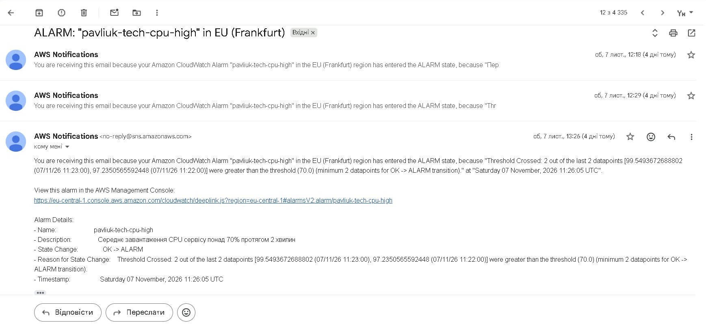
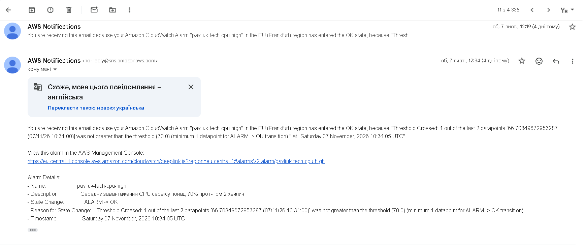

# Сповіщення CloudWatch

## 1. Умова спрацювання

Обрана умова — завантаження CPU понад 70% протягом 2 хвилин.

Налаштування в `terraform/monitoring.tf`, алерт `pavliuk-tech-cpu-high`.

Параметри:
- Метрика — `CPUUtilization` (`AWS/ECS`), статистика `Average`.
- Поріг — 70%.
- Період — 60 секунд.
- Кількість періодів оцінювання — 2 з 2.
- Канал доставки — Amazon SNS, протокол `email`.

Поріг 70% вищий за ціль автомасштабування (60%), бо трохи вище за 60% — нормальний стан, з яким автомасштабування справляється саме. Якщо ж CPU тримається вище за 70% дві хвилини, значить воно не встигає, і людині варто про це знати. Вимога «2 хвилини» потрібна, щоб короткий сплеск (наприклад, під час старту задачі) не давав листів ALARM → OK → ALARM підряд.

Сповіщення надсилаються при переходах `OK → ALARM` (`alarm_actions`) і `ALARM → OK` (`ok_actions`). Після `terraform apply` треба підтвердити підписку в листі від AWS, інакше листи не приходять.

## 2. Сповіщення про надмірне навантаження

*Рис. 1 — Лист Amazon SNS про перехід алерту в стан ALARM.*

На скріні відкрито лист з прогону 7 листопада о 13:21: стан змінився з `OK` на `ALARM` о 13:26:05 (за Києвом). У тексті листа видно причину: CPU 99,5% о 13:23 і 97,2% о 13:22 UTC, обидві точки вищі за 70%.

У списку вище видно лист о 12:29 з першого тесту. Лист о 12:18 — це ручна перевірка командою `aws cloudwatch set-alarm-state`.

## 3. Сповіщення про повернення до норми

*Рис. 2 — Лист Amazon SNS про перехід алерту в стан OK.*

Після першого тесту алерт повернувся в `OK` о 12:34:05 (за Києвом): CPU впав до 66,7%, тобто став нижчим за поріг. Для повернення в `OK` достатньо однієї точки нижче порогу. Лист о 12:19 — завершення тієї самої ручної перевірки.

## 4. Час реакції системи

| Подія (за Києвом) | Перший тест | Прогін о 13:21 |
|---|---|---|
| Старт k6 | 12:23 | 13:21:24 |
| Початок сталого навантаження | 12:25 | 13:23:24 |
| Лист ALARM | 12:29 | 13:26:05 |
| Від початку сталого навантаження до листа | ~4 хв | ~2,7 хв |
| Лист OK | 12:34:05 | — |

Затримка складається з чотирьох частин: CPU має бути вищим за 70% дві повні хвилини; метрики ECS приходять у CloudWatch із запізненням на 1–2 хв; CloudWatch перевіряє алерт раз на хвилину; лист через SNS доставляється за кілька секунд.

Для навчального проєкту така затримка прийнятна: автомасштабування реагує саме, а лист потрібен людині, лише коли воно не впоралось. Для реального сервісу краще робити алерт не на CPU, а на те, що відчуває користувач (латентність p95 або частку 5xx), і надсилати його не лише на пошту, а й у месенджер.
