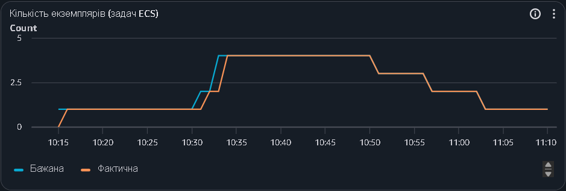
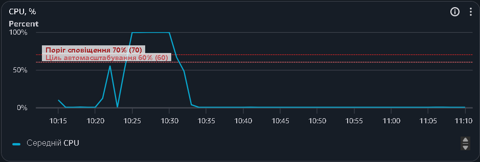
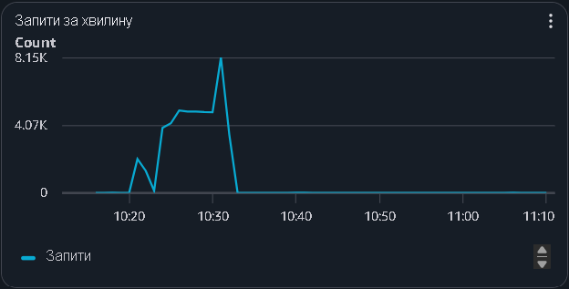
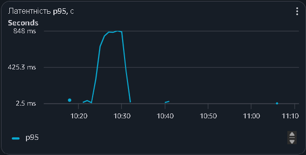
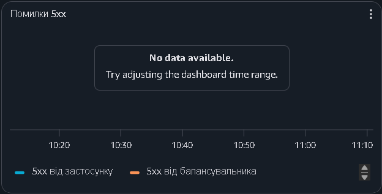

# Автоматичне масштабування

## 1. Обрані параметри

Сервіс — Amazon ECS Fargate (0.25 vCPU, 512 МБ на задачу)  
Тип масштабування — TargetTrackingScaling  
Метрика — `ECSServiceAverageCPUUtilization`  
Цільове значення — 60%  
Мінімальна кількість задач — 1  
Максимальна кількість задач — 4  
Scale-out cooldown — 60 секунд  
Scale-in cooldown — 300 секунд  

Налаштування лежать у `terraform/autoscaling.tf`.

## 2. Обґрунтування цільового значення

Нова задача з'являється через кілька хвилин, і весь цей час старі задачі мають витримувати навантаження. При цілі 60% лишається запас 40%. Якби ціль була 90%, CPU встиг би впертися в 100% ще до появи нової задачі. При 20% задачі майже весь час простоювали б, а платити за них однаково треба.

## 3. Період стабілізації (cooldown)

Cooldown — це пауза після зміни кількості задач, протягом якої політика не робить наступний крок у тому ж напрямку. Нова задача стартує не одразу, а CPU в CloudWatch оновлюється із затримкою, тому системі треба дати час побачити результат попереднього кроку.

Якщо cooldown = 0:
- при зростанні політика ще бачить старий високий CPU і додає задачі одну за одною до максимуму, хоча могло вистачити двох;
- при спаді задачі прибираються занадто швидко, решта перевантажується, і задачі знову додаються. Кількість задач стрибає туди-сюди.

## 4. Результати моніторингу CloudWatch

Тест: `./loadtest/run.sh 40`, 7 листопада 2026 року, кеш увімкнено. Час на графіках у UTC (Київ на 2 години більше). Навантаження тривало приблизно з 10:23 до 10:32 UTC (12:23–12:32 за Києвом).

### 4.1. Кількість екземплярів

*Рис. 1 — Бажана (DesiredTaskCount) і фактична (RunningTaskCount) кількість задач.*

На графіку видно повний цикл 1 → 2 → 4 → 3 → 2 → 1. Час подій з історії автомасштабування і подій ECS:

| Час (UTC) | Подія |
|---|---|
| 10:30:41 | бажана кількість стала 2 |
| 10:31:07 | друга задача пройшла перевірку і отримала трафік |
| 10:32:41 | бажана кількість стала 4 |
| 10:51 | перше вилучення (4 → 3) |
| 10:57 | 3 → 2 |
| 11:03 | 2 → 1 |

Між перетином порогу CPU (близько 10:24) і появою нової задачі минуло приблизно 6,5 хв. Із чого воно складається: метрика CPU потрапляє в CloudWatch із запізненням на 1–2 хв; прихований алерт автомасштабування спрацьовує, лише якщо CPU вищий за 60% три хвилини поспіль; сам запуск задачі займає близько 30 с (рішення о 10:30:41, задача в балансувальнику о 10:31:07).

Тест тривав 9 хв, а сталий етап 5 хв, тому друга задача з'явилась на самому кінці сталого навантаження, а четверта вже на спаді.

Вилучення задач відбулось набагато пізніше за спад навантаження. Алерт на зменшення (`AlarmLow`) чекає близько 15 хв низького CPU, а між вилученнями діє cooldown 5 хв, тому задачі прибираються по одній приблизно кожні 6 хв. До того ж перед зупинкою задача виводиться з балансувальника (`deregistration_delay` 30 с), і запити, що вже обробляються, встигають завершитись. Потім ECS надсилає SIGTERM, і uvicorn коректно завершує роботу.

### 4.2. Використання CPU

*Рис. 2 — Середнє завантаження CPU сервісу. Пунктирні лінії — ціль автомасштабування 60% і поріг сповіщення 70%.*

CPU перетнув 60% приблизно о 10:24, а на сталому навантаженні дійшов до 100%. Після додавання задач і закінчення тесту впав майже до нуля.

### 4.3. Кількість запитів

*Рис. 3 — Кількість запитів через ALB за хвилину.*

Невеликий пік о 10:21 — пробний запуск на одну хвилину перед основним тестом.

### 4.4. Латентність p95

*Рис. 4 — 95-й перцентиль часу відповіді ALB.*

Під час навантаження p95 сягала 848 мс. Після спаду навантаження вона повернулась до кількох мілісекунд.

### 4.5. Помилки 5xx

*Рис. 5 — Відповіді 5xx від застосунку і від балансувальника.*

Графік порожній, бо помилок 5xx не було. Якщо за хвилину сталося 0 помилок, ALB просто не записує точку в CloudWatch. Це збігається з k6: частка помилок у тесті 0%.
