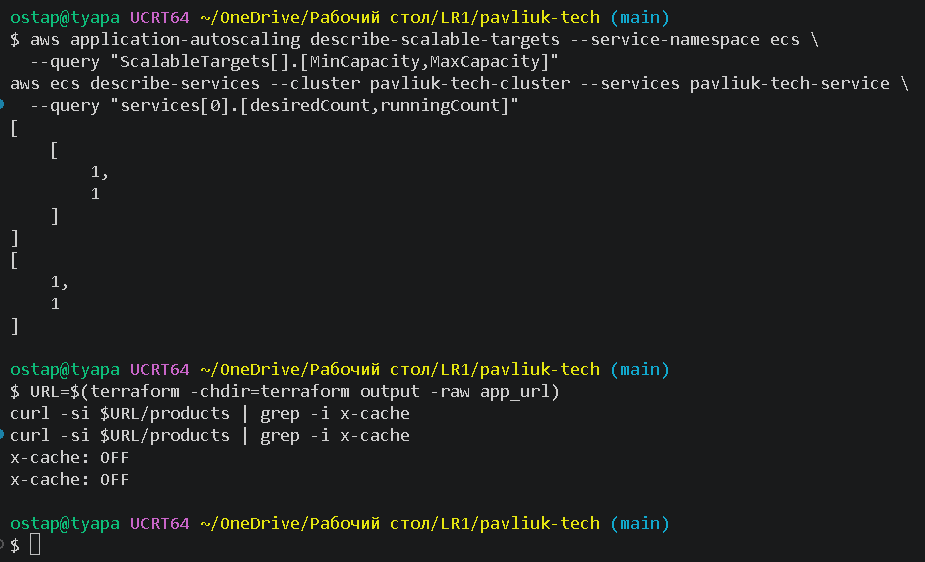
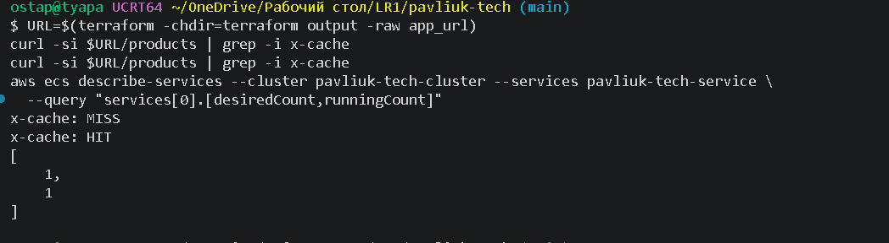
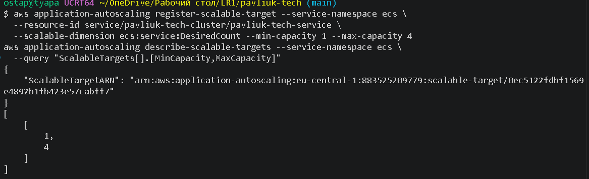
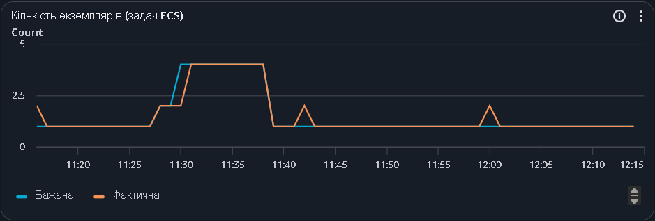
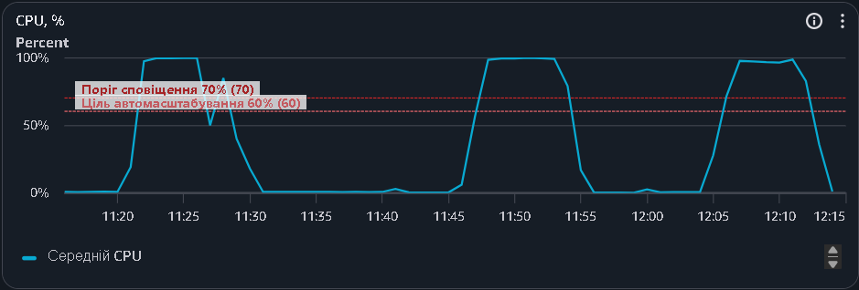
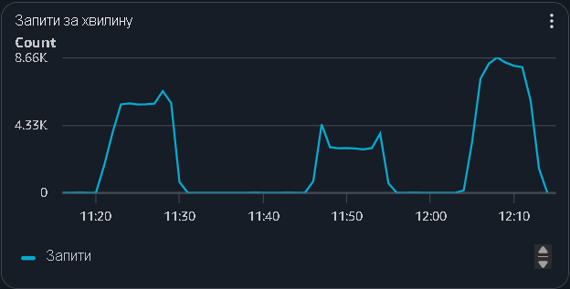
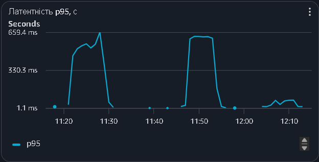
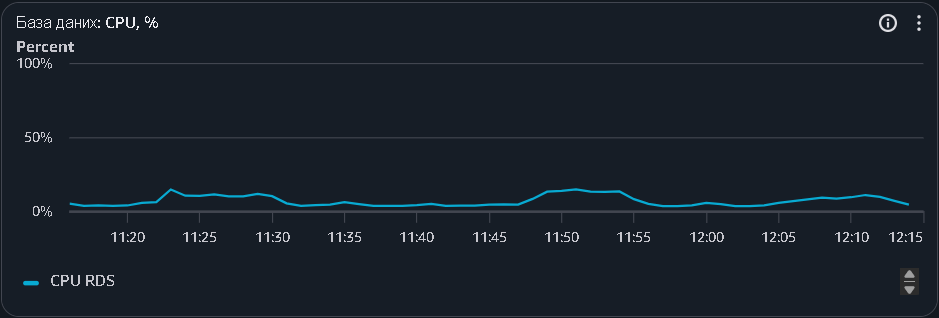
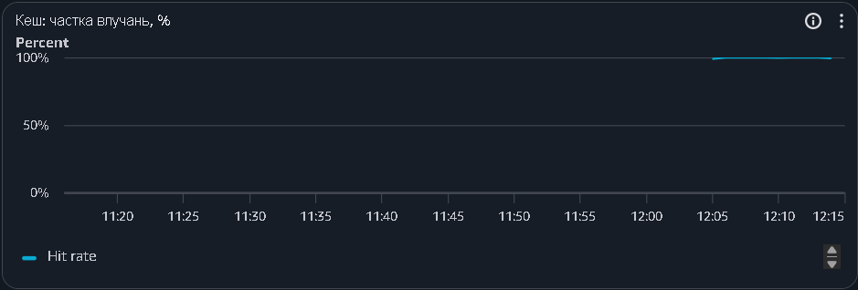

# Кешування операцій читання

## 1. Як працює кеш

Кешується `GET /products` — найчастіший запит у сценарії (4 з 10). Використано схему cache-aside (`app/cache.py`, `app/main.py`):

1. Застосунок шукає в Redis ключ із параметрами запиту (`category_id`, `q`, `limit`, `offset`).
2. Якщо ключ є, віддає збережену відповідь із заголовком `X-Cache: HIT`, база не потрібна.
3. Якщо ключа немає, читає дані з бази, кладе відповідь у Redis на 30 с і віддає її з `X-Cache: MISS`.

При `CACHE_ENABLED=false` заголовок `X-Cache: OFF`, кеш не використовується. Якщо Redis недоступний, застосунок читає з бази.

Redis — Amazon ElastiCache (`cache.t4g.micro`) у приватній підмережі, доступ лише від security group застосунку (`terraform/elasticache.tf`). Він один на всі задачі. Кеш у пам'яті процесу погано підходить для кількох задач: кожна мала б власний кеш і окремо ходила б у базу, різні задачі віддавали б різні версії даних, а нова задача стартувала б з порожнім кешем.

## 2. Як проводилось порівняння

Обидва прогони на одній задачі (ліміт 1–1), N = 20, 7 листопада 2026 року. Команди наведено в `README.md`.

Перед прогоном без кешу: ліміт 1–1 і `X-Cache: OFF`.

*Рис. 1 — Перевірка перед прогоном без кешу.*

Перед прогоном з кешем: `MISS`, потім `HIT`, одна задача.

*Рис. 2 — Перевірка перед прогоном з кешем.*

Після тестів ліміт повернено до 1–4.

*Рис. 3 — Ліміт автомасштабування знову 1–4.*

## 3. Результати

| Показник | Без кешу | З кешем |
|---|---:|---:|
| Латентність p95, усі запити | 598 мс | 80 мс |
| Латентність p95, `GET /products` | 592 мс | 67 мс |
| Латентність p50, усі запити | 195 мс | 35 мс |
| Запитів за секунду | 49 | 110 |
| Тривалість циклу користувача | 3,2 с | 1,4 с |
| Навантаження на БД (CPU RDS) | ~15% | ~10% |
| Частка влучань у кеш | — | 99,87% |
| Частка помилок | 0% | 0% |

Прогін без кешу — приблизно 11:46–11:55 UTC, з кешем — 12:04–12:13 UTC (на графіках нижче час у UTC).

*Рис. 4 — Кількість задач під час порівняння. Спад 4 → 1 о 11:40 — це ручне встановлення ліміту 1–1, а короткі сходинки о 11:42 і 12:00 — деплої (нова задача замінює стару).*

*Рис. 5 — CPU сервісу. У прогоні без кешу (11:46–11:55) і з кешем (12:04–12:13) одна задача завантажена на 100%.*

*Рис. 6 — Запити за хвилину. З кешем (праворуч) запитів значно більше.*

*Рис. 7 — Латентність p95. Без кешу (середній пік) близько 650 мс, з кешем (праворуч) кілька десятків мілісекунд.*

*Рис. 8 — Завантаження CPU бази даних.*

*Рис. 9 — Частка влучань у кеш Redis.*

Що видно з результатів:
- З кешем швидшими стали всі запити, не лише список. Відповідь з кешу — це готовий JSON з Redis: не потрібні ні запит у базу, ні перетворення 50 товарів у JSON. Процесор задачі звільнився, черга до нього зменшилась.
- Запитів за секунду стало в 2,2 раза більше, бо кожен користувач проходить цикл швидше (3,2 с → 1,4 с) і за той самий час встигає зробити більше запитів.
- Навантаження на базу змінилось мало, бо вона й без кешу була завантажена слабо. Вузьке місце — CPU задачі.

Перший варіант порівняння (N = 40 з автомасштабуванням 1–4, див. `LOADTEST.md`) показав p95 786 мс з кешем і 584 мс без нього. Він некоректний: без кешу CPU раніше перетнув поріг, і задачі додались раніше, тож порівнювалась кількість задач. Тому порівняння повторено на одній задачі.

## 4. Застарівання даних

TTL становить 30 секунд. Після запису в базу клієнт може бачити застарілий список до 30 секунд. Окремий товар `GET /products/{id}` не кешується, тому там дані завжди свіжі.

Скоротити цей час можна трьома способами:
- зменшити TTL: дані свіжіші, але до бази йде більше запитів;
- інвалідація: після кожного запису видаляти з Redis ключі `products:list:*`;
- write-through: оновлювати кеш одночасно із записом у базу.

Коли запис у кеші закінчується, багато запитів можуть одночасно піти в базу (cache stampede). Захиститись можна блокуванням, при якому кеш перезаповнює лише один запит, або випадковою добавкою до TTL, щоб різні ключі не закінчувались одночасно.
