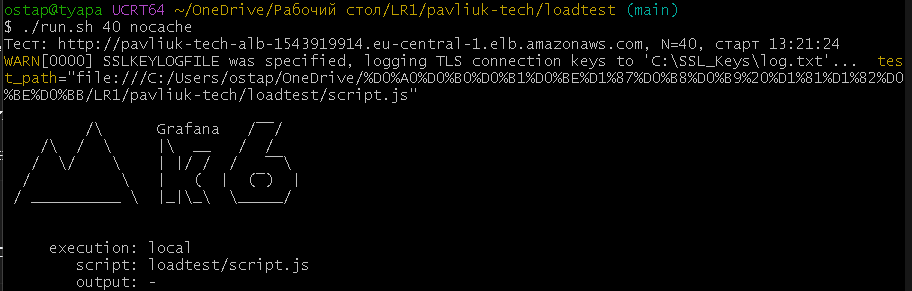

# Навантажувальне тестування

## 1. Команда запуску

```bash
./loadtest/run.sh 40
```

`run.sh` бере адресу застосунку з `terraform output app_url`, запускає k6 (`loadtest/script.js`) і зберігає результат у `loadtest/results/`. Другий аргумент задає мітку для файлу:

```bash
./loadtest/run.sh 20 cache-1task
```



*Рис. 1 — Запуск тесту: адреса, N і час старту.*

## 2. Параметри тестування

Інструмент — k6  
Кількість віртуальних користувачів (N) — 40  
Сценарій одного користувача — 1 запис і 9 читань за цикл, потім пауза 1 с.

| Запит | Разів за цикл |
|---|---|
| `POST /products`, новий товар з унікальним артикулом | 1 |
| `GET /products`, список | 4 |
| `GET /products/{id}`, щойно створений товар | 1 |
| `GET /products/{id}`, випадковий товар (404 не вважається помилкою) | 1 |
| `GET /categories` | 2 |
| `GET /products/{id}/movements` | 1 |

Фази навантаження:

Наростання від 0 до N користувачів — 2 хвилини.  
Стале навантаження з N користувачами — 5 хвилин.  
Зменшення від N до 0 — 2 хвилини.

N = 40 обрано тому, що одна задача (0.25 vCPU) повністю завантажується вже при 20 користувачах (див. `CACHE.md`), тож при 40 CPU гарантовано перевищує ціль 60% і спрацьовує масштабування.

## 3. Результати тестування

7 листопада 2026 року, N = 40, автомасштабування 1–4.

| Показник | З кешем | Без кешу |
|---|---:|---:|
| Кількість HTTP-запитів | 44 321 | 46 961 |
| Запитів за секунду | 82 | 87 |
| Частка помилок | 0% | 0,002% (1 запит) |
| Латентність p50 | 288 мс | 290 мс |
| Латентність p95 | 786 мс | 584 мс |
| Латентність p99 | 999 мс | 759 мс |
| Максимум задач | 4 | 4 |
| Частка влучань у кеш | 99,66% | — |

Без кешу результат навіть трохи кращий, але це не заслуга відсутності кешу: у цьому прогоні нові задачі з'явились раніше, тож порівнювалась різна кількість задач. Коректне порівняння на одній задачі наведено в `CACHE.md`.

Єдина помилка в прогоні без кешу — один `POST /products`, цикл якого тривав 23 с. Імовірно, запит потрапив на задачу в момент її запуску чи зупинки.
