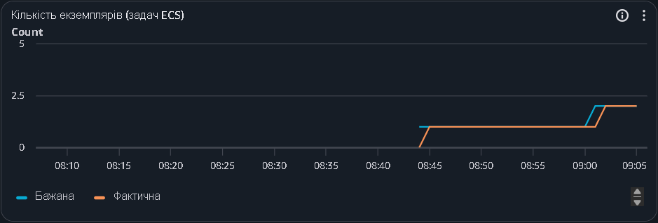

# Масштабування за розкладом

## 1. Налаштування масштабування

Масштабування ECS Fargate за розкладом налаштовано в `terraform/schedule.tf` ресурсом `aws_appautoscaling_scheduled_action`. Вмикається рядком `enable_schedule = true` у `terraform.tfvars`.

| Період | Час (Europe/Kyiv) | Мінімум задач | Максимум задач |
|---|---|---:|---:|
| День | з 11:00 | 2 | 4 |
| Ніч | з 22:00 | 1 | 4 |

Розклад змінює лише мінімум. Автомасштабування за CPU працює й далі, тож вдень задач може бути від 2 до 4, а вночі від 1 до 4.

Масштабування до нуля не використовується. Сервіс стоїть за балансувальником, і коли задач немає, ALB відповідає 503. Сам сервіс від запиту не «прокинеться», бо в ECS немає запуску з нуля за першим запитом, як у Cloud Run.

## 2. Перевірка роботи

11 листопада 2026 року, без навантаження. О 11:00 за Києвом (09:00 UTC) розклад підняв мінімум до 2: о 09:01 бажана кількість стала 2, о 09:02 працювали вже дві задачі.

*Рис. 1 — Кількість задач: перехід з 1 на 2 о 09:00 UTC (11:00 за Києвом). Час на графіку в UTC.*

О 22:00 мінімум знову стане 1, але друга задача зупиниться не одразу: її прибере звичайне автомасштабування приблизно через 15 хв низького CPU.

## 3. Розрахунок місячної економії

Одна задача: 0,25 vCPU і 0,5 ГБ.

Для розрахунку використано орієнтовні тарифи Fargate в eu-central-1 (Linux, x86): vCPU — $0,0466 за годину, пам'ять — $0,0051 за ГБ на годину. Перед здачею їх варто звірити на сторінці цін AWS.

Вартість однієї задачі за годину: 0,25 × 0,0466 + 0,5 × 0,0051 ≈ $0,0142.

Розрахунок для 30 днів.

**Без розкладу (2 задачі цілодобово):** 2 × 24 × 30 = 1440 задачо-годин, 1440 × 0,0142 ≈ $20,4.

**З розкладом (11 годин по 2 задачі, 13 годин по 1):** (2 × 11 + 1 × 13) × 30 = 1050 задачо-годин, 1050 × 0,0142 ≈ $14,9.

**Місячна економія:** 20,4 − 14,9 ≈ $5,5, тобто близько 27%.

Розрахунок враховує лише мінімум задач. Додаткові задачі від автомасштабування коштують однаково в обох варіантах. Redis, RDS, ALB і NAT не враховано.
